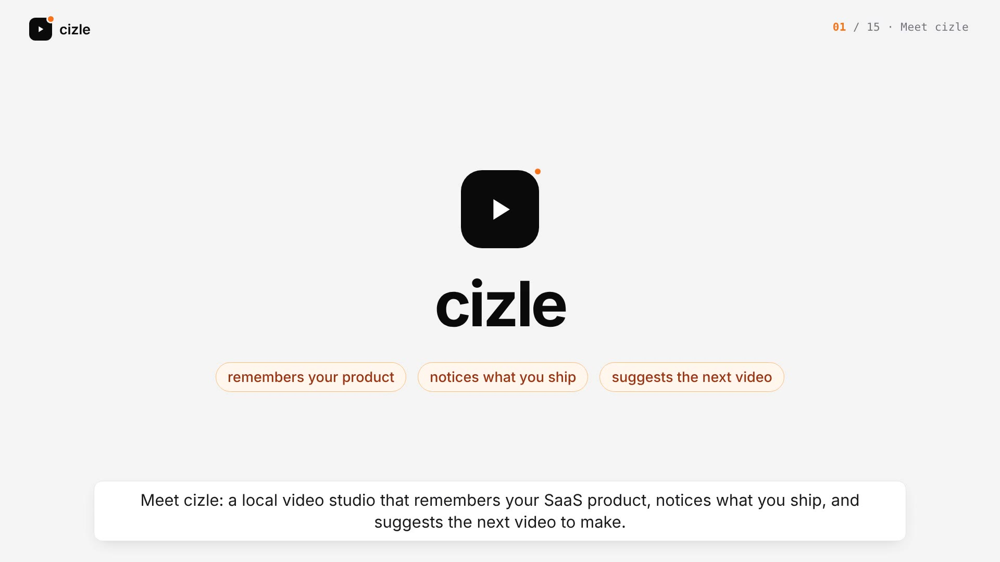
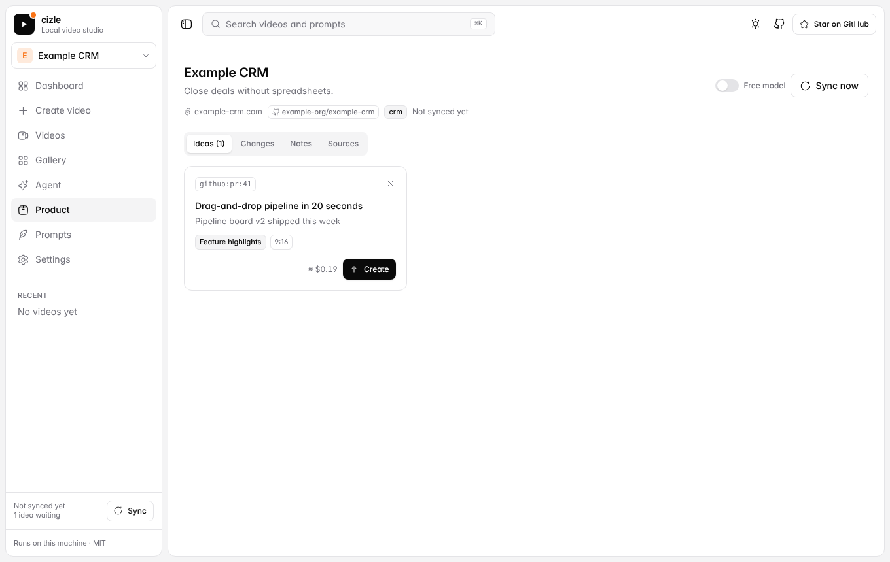
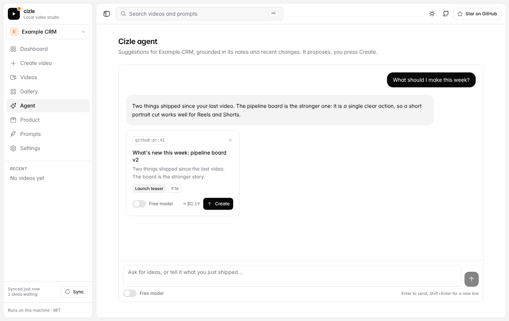
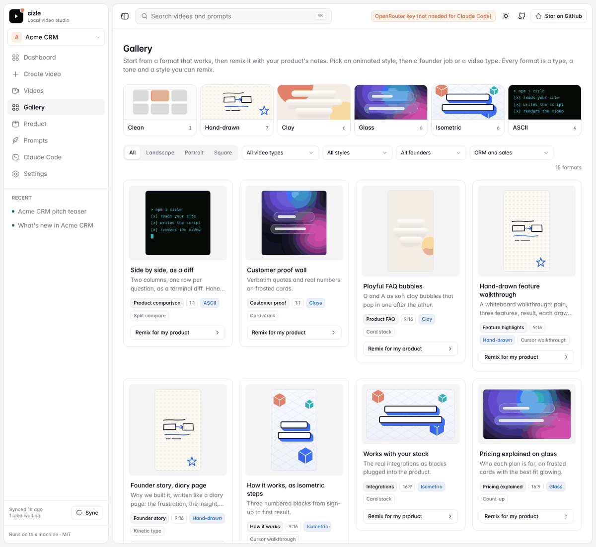

<div align="center">

# cizle

**Your product, remembered. Videos that keep up with what you ship.**

Add your SaaS website and GitHub repos once. cizle reads them, remembers them as markdown, notices what you ship, and suggests the next video. Showcase, feature, FAQ, comparison, glossary and launch videos, in landscape, portrait or square, made from your real product.

Runs on your machine. No database, no accounts. Powered by [OpenRouter](https://openrouter.ai), with free models if you want $0 runs.

<a href="docs/demo.mp4"></a>

**[▶ Watch the 50-second demo with sound](docs/demo.mp4)**

**[▶ Watch the 5-minute walkthrough of every feature](docs/overview.mp4)** · [captions (.srt)](docs/overview.srt)

<a href="docs/overview.mp4"></a>

</div>

---

## Contents

- [Why](#why) · [Quick start](#quick-start) · [What you can do](#what-you-can-do)
- [Product memory](#product-memory) · [Sync](#sync-what-shipped) · [The agent](#the-agent) · [Gallery](#gallery-and-remix)
- [Free or paid models](#free-or-paid-models) · [Stop anything](#stop-anything)
- [Video types and formats](#video-types-and-formats) · [The prompt library](#the-prompt-library)
- [How it works](#how-it-works) · [Cost](#cost) · [Use it from Claude Code](#use-it-from-claude-code)
- [API](#api) · [Configuration](#configuration) · [Project layout](#project-layout) · [Security](#security)
- [Contributing](#contributing) · [Credits](#credits) · [License](#license)

## Why

Every launch needs videos: a showcase for the landing page, an FAQ for the pricing page, a comparison for the sales deck, a teaser for launch day. Screen recordings are slow, generic AI video does not know your product, and the product changes every week.

cizle reads **your actual product** (website, `llms.txt`, blog, FAQ, pricing and docs pages, GitHub repos), takes real screenshots, writes a script grounded in what it read, and renders the video. Every claim comes from your sources. Then it keeps watching: when you merge a PR or publish a page, it suggests the video that goes with it.


## Quick start

```bash
git clone https://github.com/shreyvijayvargiya/cizle.git
cd cizle
npm install
npm run dev
```

Open **http://localhost:5173**.

1. **Settings** → paste your OpenRouter key.
2. Sidebar → product menu → **Add product**. Paste your website and any GitHub repos.
3. Press **Create** on one of the suggested videos, or describe your own in the composer.

You need Node 20.12+. Chrome (for screenshots) is downloaded by `puppeteer` on install, and FFmpeg is bundled.

To run it as a single server: `npm run build && npm start`, then open http://localhost:3737.

## What you can do

| | |
|---|---|
| **Add a product** | Website plus any number of GitHub repos. cizle writes `products/<slug>/product.md` and suggests three first videos. |
| **Switch products** | Sidebar dropdown. Videos, composer, gallery and agent follow the active product. |
| **Sync** | Finds new commits, releases and pages since last time, turns them into plain-language changes and video ideas. |
| **Create from an idea** | Every idea cites its source (`github:pr:41`, `site:/pricing`). Press **Create**. Nothing renders before that. |
| **Describe your own video** | Composer with type, tone, aspect ratio, audio, length and 1–3 variations. Type `/` to load a saved prompt. |
| **Ask the agent** | Chat about what to make next. It reads your notes, changes and past videos, and proposes videos. |
| **Remix from the gallery** | 16 formats across 8 SaaS categories, landscape, portrait and square, with different motion styles. |
| **Use free models** | A switch next to every generate button. Free OpenRouter models, $0, rate limited. |
| **Stop anything** | Every button that starts work turns into **Stop** while it runs. |
| **Edit everything** | Notes, prompts, ideas and settings are plain files you can open in any editor. |



## Product memory

cizle remembers each product as markdown in `products/<slug>/` on your machine:

```
products/<slug>/
├── product.md     positioning, features, pricing, tone (edit it: every video reads it)
├── changes.md     what shipped since each sync, newest first
├── ideas.md       video ideas: suggested → created / dismissed
├── sources.json   sync state: last commit per repo, page hashes, seen releases
└── assets/        screenshots kept when the product was added
```

- **Add a product** from the sidebar menu. Give it a website, a GitHub repo, or both, plus any extra repos (`owner/app, owner/docs, owner/api`). cizle reads the site, `llms.txt`, blog, pricing and docs pages and the first repo (cloned locally), reads the other repos' READMEs, and writes the notes with one model call.
- Each fact in `product.md` carries its source, for example `*(site:/pricing)*` or `*(github:README)*`.
- The **Product** page shows ideas, changes, notes (with a markdown editor) and sources (name, website, repos). Fix anything that is wrong. The next video reads your correction.
- The folder is git-ignored except `products/example/`, a committed reference. Your notes never land in the open-source repo. If you fork cizle for your own product you can commit them.
- Set `CIZLE_PRODUCTS_DIR` to keep the folder somewhere else.

## Sync: what shipped

Press **Sync** in the sidebar (or on the Product page). cizle also checks when it starts and every 6 hours while it runs (turn this off in Settings → *Keep products fresh*).

| Source | How it is read |
|---|---|
| **GitHub repos** | A shallow, blobless `git fetch` into a local cache, then `git log` since the last commit it saw. Releases come from the public `releases.atom` feed. **No GitHub API and no token for public repos.** |
| **Private repos** | Put `GITHUB_TOKEN` in `.env`. It is only used for the git fetch and is stripped from error messages. |
| **Website** | `sitemap.xml` (or homepage links) for new pages. Content hashes on the homepage, pricing, features, changelog and similar pages for changes. |

Merged PRs, releases and new pages are what count. Dependency bumps, CI changes, merge noise and bot commits are dropped before the model sees anything. If nothing changed, **no model is called**. Otherwise one call writes `changes.md`, adds new features to `product.md`, and adds up to four ideas to `ideas.md`, each naming its source.

## The agent

Sidebar → **Agent**. Ask "what should I make this week?" and it reads your product notes, recent changes, queued ideas and past videos before answering, then proposes up to three videos as cards with a **Create** button.

- It can read your notes, run a sync, and **propose** videos. It has **no way to start a render**. Only your click spends money.
- Text from websites and repositories is treated as data, not instructions, so a hostile page or commit message cannot make it create videos.
- If a free model cannot call tools, it falls back to answering from your notes in one shot.
- Its persona and rules live in [`prompts/agent.md`](prompts/agent.md). Edit them.



## Gallery and remix

Sidebar → **Gallery**. Sixteen formats across the types, aspect ratios (landscape, portrait, square) and motion styles (kinetic type, UI zoom, cursor walkthrough, split compare, device mockup, count-up, card stack, glitch cut), filterable by category. **Remix for my product** opens the composer with that format's type, tone, aspect ratio and direction, and your product's website and repos filled in. Your own finished videos for the active product appear below.

The previews are small animated samples of each motion style. Presets are plain JSON in [`gallery/presets/`](gallery/presets), so adding one is a pull request.



## Free or paid models

The **Free model** switch sits next to every generate button (composer, ideas, agent, onboarding, sync). It is remembered between visits, and a brand-new install starts on free.

| | Free | Paid |
|---|---|---|
| Script, brief, agent | best free text model OpenRouter lists | your **Script model** |
| Screenshot reading | best free vision model | your **Vision model** |
| Voice-over | not available: runs use music or silence | your **Voice model** |
| Cost shown | $0 | estimate before you run |

- The free list is fetched live from OpenRouter's model list (cached for an hour), so it never goes stale in the repo. Pin your own in Settings → *Free script model* / *Free vision model*, or leave them on `auto`.
- Free models are rate limited and a little less reliable with strict JSON. cizle retries and shows a clear message when a limit is hit, with the option to switch to paid.
- You still need an OpenRouter key for free models.

## Stop anything

Every button that starts work shows **Stop** while it runs, in the same place as the generate button.

| Where | What Stop does |
|---|---|
| Composer, idea cards | Cancels the request. If the video was already queued it is stopped too. |
| Running video (detail page, list, dashboard **Running now**) | Cancels the job: model calls, downloads, git and FFmpeg processes are aborted and open browser pages closed. The video is marked **Stopped**. |
| Add product | Cancels the read. **Nothing is saved.** |
| Sync | Cancels the fetch and the model call. `changes.md`, `ideas.md` and `sources.json` are left untouched. |
| Agent | Cancels the request and puts your question back in the box. |
| Settings → Test key | Cancels the check. |

Cancellation is built in: work that can be stopped runs inside a cancellable scope, and every network request, child process and browser page inside it listens for the stop. A model call that was already running may still be billed by your provider for tokens it generated before it stopped.

## Video types and formats

| Video type | What it does | Needs |
|---|---|---|
| **Product showcase** | A polished tour built around real screenshots | a URL |
| **Feature highlights** | Fast cuts, one feature per scene | a URL |
| **Product FAQ** | The top buyer questions, answered from your own FAQ and docs | an FAQ section, docs or `llms.txt` |
| **Product comparison** | Side-by-side table against competitors, using only facts on both sites | competitor URLs |
| **Glossary explainer** | Teaches the key terms in your space | docs or blog |
| **Launch teaser** | Big type, few words, strong CTA | a URL |

Each run gives you **1–3 different videos**, up to 59 seconds, in **9:16, 1:1 or 16:9**, with:

- **audio** of your choice: voice-over + music, music only, or silent
- burned-in captions plus an `.srt` file
- a ready-to-post social caption
- the full script, every frame and screenshot

Everything is saved in `data/videos/`.

<p align="center"></p>

## The prompt library

All creative direction is plain markdown, so you can read it, edit it and send PRs for it.

```
prompts/
├── laws.md            rules every video follows (hook in 2 s, readable, grounded, no "supercharge")
├── agent.md           the agent's persona and rules
├── types/             one file per video type: structure, pacing, rules
│   └── showcase.md  features.md  faq.md  comparison.md  glossary.md  launch.md
├── tones/             polished, playful, cinematic, app-store, deadpan
└── custom/            prompts you create in the dashboard (Prompts → New prompt)
```

- **Add a video type:** drop a new `prompts/types/<name>.md` file. It shows up in the dropdown straight away.
- **Use a prompt:** type `/` in the composer, or click **Load prompt**.

A prompt file looks like this:

```markdown
---
name: Dev tool launch
description: Launch cut for developers, built around the install command.
kind: custom
type: launch
---
- Show the install command on screen within 8 seconds.
- Include one short code scene from the README.
- End with "Star it on GitHub".
```

<p align="center"></p>

## How it works

```
 add product ─┬─ homepage, llms.txt, blog, FAQ markup, pricing/docs pages    (read in parallel)
              ├─ GitHub repos (first cloned, others by README)
              └─ screenshots + product images (headless Chrome)
                          │
                          ▼
              products/<slug>/product.md  ←── edit it any time
                          │
        sync ─────────────┤   new commits · releases · new and changed pages
                          ▼
              changes.md  +  ideas.md  ──►  idea cards / agent proposals
                                                   │  you press Create
                                                   ▼
  vision model scores every frame  →  evidence-backed brief (+ your product notes)
                          │
  prompts/types/<type>.md + prompts/tones/<tone>.md + your direction + prompts/laws.md
                          │
          1–3 storyboards in parallel  →  frames  →  voice-over  →  FFmpeg  →  MP4
```

## Cost

You pay OpenRouter for model usage; cizle itself is free. Free models cost nothing.

| Per run | Default paid model | ≈ USD |
|---|---|---|
| Screenshot analysis | `google/gemini-2.5-flash` | 0.01 |
| Product brief + concepts | `anthropic/claude-sonnet-4` | 0.06 |
| Script, per video | `anthropic/claude-sonnet-4` | 0.05 |
| Voice-over, per minute | `openai/gpt-audio-mini` | 0.03 |
| Add a product (one-off) | script model | ≈ 0.05 |
| Sync with changes | script model | ≈ 0.01–0.03 |

These are rough estimates: a 30 s narrated video costs about **$0.10–0.20**, and silent videos cost less. The dashboard shows an estimate before you generate and the actual cost after. Auto-sync only calls a model when something changed. You can change any model in Settings.

## Use it from Claude Code

[`SKILL.md`](SKILL.md) lets coding agents drive cizle while the dev server is running. Try:

- "Make a FAQ video for this project with cizle."
- "What should I make a video about this week?" (the agent syncs, reads the ideas, and asks before creating anything)
- "Add https://mysaas.com and my repos to cizle."

## API

The dashboard is a client of a small local API (port 3737), so you can script it:

```bash
curl -X POST localhost:3737/api/videos -H 'content-type: application/json' -d '{
  "url": "https://yoursaas.com",
  "github_url": "https://github.com/you/repo",
  "type": "faq",
  "tone": "polished",
  "prompt": "Aim it at agency owners",
  "aspect": "9:16",
  "audio": "voice",
  "duration_sec": 30,
  "variations": 2,
  "model_tier": "free",
  "product": "yoursaas"
}'
# → { "id": "…", "status": "pending" }   then poll GET /api/videos/:id
```

| Method | Path | |
|---|---|---|
| `POST` | `/api/videos` | start a job (`model_tier`: `free` or `paid`, optional `product`) |
| `GET` | `/api/videos` · `/api/videos/:id` | list (`?product=`) · status, script, cost, files |
| `POST` | `/api/videos/:id/cancel` | stop a running job |
| `POST` | `/api/videos/:id/regenerate` | same settings, new take |
| `GET` | `/api/products` · `/api/products/:slug` | products and their memory |
| `POST` | `/api/products/onboard` | add a product (background run) |
| `GET` | `/api/products/onboard/:id` | onboarding progress |
| `POST` | `/api/products/onboard/:id/cancel` | stop onboarding (nothing is saved) |
| `PUT` `DELETE` | `/api/products/:slug` | edit notes, name, site, repos · delete |
| `POST` | `/api/products/:slug/sync` | look for new commits, releases and pages |
| `GET` `PATCH` | `/api/products/:slug/ideas[/:id]` | video ideas · dismiss or restore |
| `POST` | `/api/products/:slug/ideas/:id/create` | turn an idea into a video |
| `POST` | `/api/products/:slug/agent` | chat with the agent |
| `GET` | `/api/gallery` | format presets plus the product's own videos |
| `GET` | `/api/models` | free and paid models in use, and the free list |
| `GET` `PUT` | `/api/settings` · `POST /api/settings/test` | keys and defaults |
| `GET` `POST` | `/api/prompts` · `/api/prompts/:id` | prompt library |
| `POST` | `/api/estimate` | cost before you run |

Closing a request that is still running (sync, agent) stops the work behind it.

## Configuration

Settings live in `data/settings.json` (git-ignored). Environment variables also work, and they win over the settings file.

| Variable | |
|---|---|
| `OPENROUTER_API_KEY` | required (or paste it in Settings) |
| `GITHUB_TOKEN` | optional: only for **private** repos. Public repos are read with plain `git`, no token |
| `UPLOADTHING_TOKEN` | optional: also upload finished videos to [UploadThing](https://uploadthing.com) |
| `CHROME_PATH` | optional: use your own Chrome instead of the downloaded one |
| `CIZLE_DATA_DIR` | optional: where videos and settings are stored (default `./data`) |
| `CIZLE_PRODUCTS_DIR` | optional: where product memory lives (default `./products`) |
| `OPENROUTER_BASE_URL` | optional: point at a proxy or a local mock instead of `openrouter.ai` |
| `PORT` | API port (default `3737`) |

Copy `.env.example` to `.env` to set them in a file.

**Settings page:** OpenRouter key, UploadThing token, default aspect ratio, audio, voice and length, the script, vision and voice models, the free script and vision models (`auto` by default), caption burn-in, and **Keep products fresh** (auto-sync at start and every 6 hours).

## Project layout

```
cizle/
├── SKILL.md                 lets coding agents drive cizle
├── prompts/                 laws, video types, tones, custom prompts, agent persona (markdown)
├── gallery/presets/*.json   gallery formats (type, tone, aspect, motion style, direction)
├── products/                your product memory (git-ignored) + example/
├── server/
│   ├── index.js             Hono API (+ serves the dashboard in production)
│   ├── settings.js models.js library.js scrape.js browser.js
│   ├── products/            store, onboard, sync, llm helpers
│   ├── agent/               the agent and its read-only tools
│   └── pipeline/            context → frames → brief → script → render (FFmpeg), cancel.js
├── web/src/
│   ├── pages/               Dashboard, Create, Videos, VideoDetail, Gallery, Agent, Product,
│   │                        Onboarding, Prompts, PromptEditor, Settings
│   └── components/          AppShell, Composer, IdeaCard, ProductSwitcher, SyncBadge, ModelToggle,
│                            RouteError, ui/ (shadcn-style: Button, Select, Menu, Dialog, Tabs, Switch…)
├── data/                    videos and settings (git-ignored)
└── docs/                    screenshots and the demo video
```

Scripts: `npm run dev` (API + dashboard with hot reload), `npm run build`, `npm start`, `npm run typecheck`.

## Security

> cizle has no login. It is built to run on your own machine; **do not expose it to the internet as-is.**

- Keys stay in `data/settings.json` or your environment. Nothing leaves your computer except the model, website and GitHub requests you trigger.
- Everything scraped from websites and repositories is passed to models inside an "untrusted data" wrapper, and the agent cannot start renders, so prompt injection from a web page cannot spend your credit.
- Auto-sync is the one thing that can use a model without a click, and only when it found a change. Turn it off in Settings.

## Contributing

- **Prompts:** add or improve files in `prompts/types`, `prompts/tones`, `prompts/agent.md`.
- **Gallery formats:** add a JSON file to `gallery/presets/`:

  ```json
  {
    "id": "launch-kinetic-portrait",
    "title": "Launch teaser, kinetic type",
    "description": "Big words land on the beat. A 15-second announcement for Reels and Shorts.",
    "type": "launch",
    "tone": "cinematic",
    "aspect": "9:16",
    "animation": "kinetic-type",
    "categories": ["devtools", "ai-agents", "marketing-seo"],
    "prompt": "Kinetic typography: one huge line per scene, each word landing on the beat."
  }
  ```

  `type` and `tone` must match a file in `prompts/`. Categories: `devtools`, `analytics`, `crm`, `ai-agents`, `project-management`, `fintech`, `marketing-seo`, `security`.
- **Dashboard:** components follow the shadcn pattern on Radix (`web/src/components/ui/`). Please use them instead of native form controls.

## Credits

- Creative laws and tones adapted from [brag](https://github.com/latent-spaces/brag) (MIT), the skill that turns a project into a launch video.
- Music: royalty-free CC0/CC-BY tracks from [Openverse](https://openverse.org), with attribution saved per video, or generated offline.

## License

MIT
