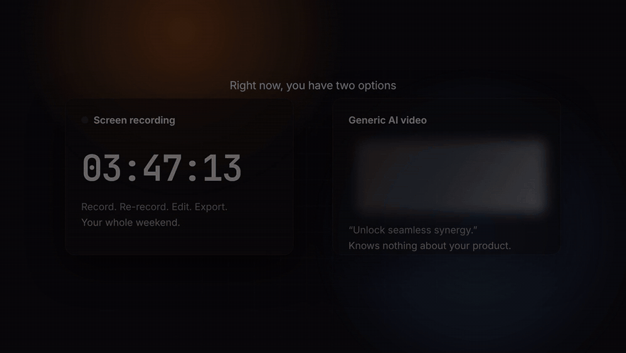
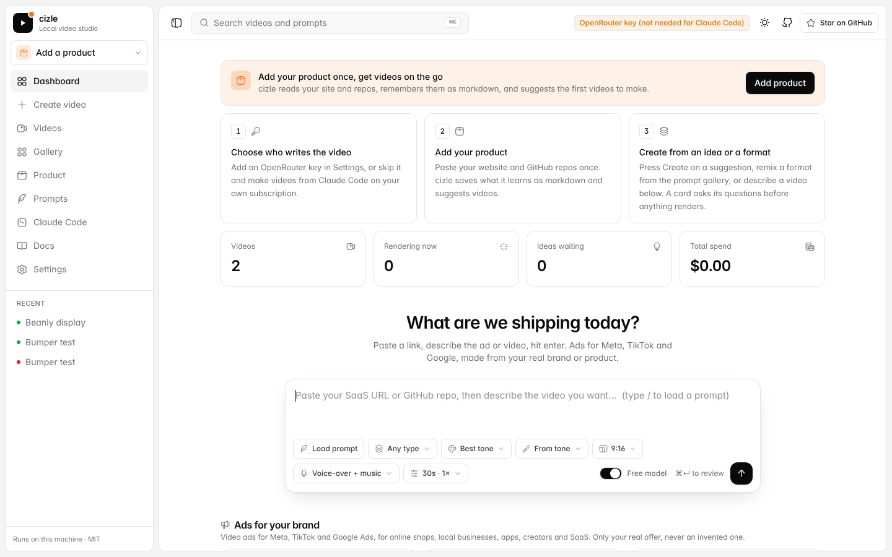
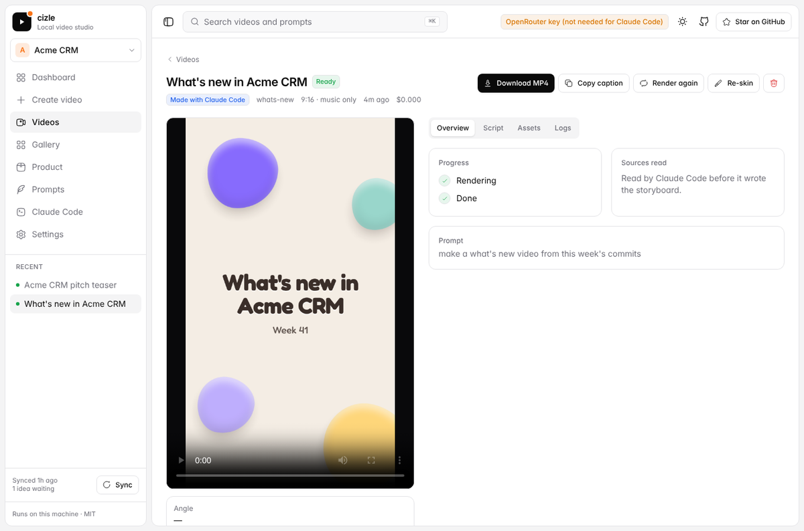
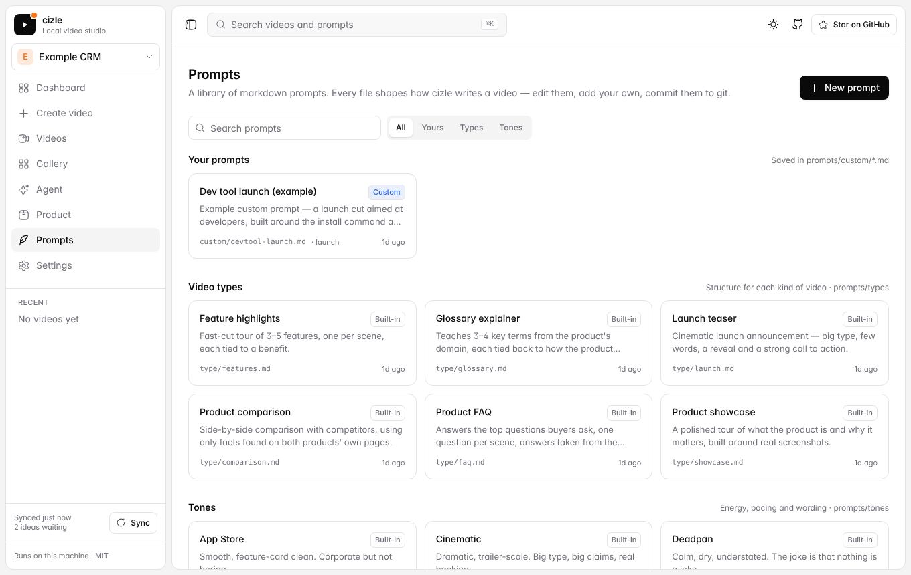

<div align="center">

# cizle

**Paste a SaaS URL or GitHub repo. Get FAQ, feature, comparison, glossary and launch videos under a minute.**

A local video studio with a markdown prompt library. Runs on your machine, powered by [OpenRouter](https://openrouter.ai).

<a href="docs/demo.mp4"></a>

**[▶ Watch the 50-second demo with sound](docs/demo.mp4)**

</div>

---

## Why

Every launch needs videos: a showcase for the landing page, an FAQ for the pricing page, a comparison for the sales deck, a teaser for launch day. Screen recordings are slow and generic AI video doesn't know your product.

cizle reads **your actual product** (website, `llms.txt`, blog, FAQ, pricing and docs pages, GitHub repo), takes real screenshots, writes a script grounded in what it read, and renders the video. Every claim comes from your sources.

## Quick start

```bash
git clone https://github.com/shreyvijayvargiya/cizle.git
cd cizle
npm install
npm run dev
```

Open **http://localhost:5173**, paste your OpenRouter key in **Settings**, then paste a link into the composer and hit enter.

You only need Node 20.12+. Chrome (for screenshots) is downloaded by `puppeteer` on install, and FFmpeg is bundled.

## What you get

| Video type | What it does | Needs |
|---|---|---|
| **Product showcase** | A polished tour built around real screenshots | a URL |
| **Feature highlights** | Fast cuts, one feature per scene | a URL |
| **Product FAQ** | The top buyer questions, answered from your own FAQ and docs | an FAQ section, docs or `llms.txt` |
| **Product comparison** | Side-by-side table against competitors, using only facts on both sites | competitor URLs |
| **Glossary explainer** | Teaches the key terms in your space | docs or blog |
| **Launch teaser** | Big type, few words, strong CTA | a URL |

Each run gives you **1–3 different videos** in **9:16, 1:1 or 16:9**, with:
- **audio** of your choice: voice-over + music, music only, or silent
- burned-in captions plus an `.srt` file
- a ready-to-post social caption
- the full script, every frame and screenshot

Everything is saved in `data/videos/`.



<p align="center"> </p>

## How it works

```
your link ─┬─ homepage, llms.txt, blog posts, FAQ markup, pricing/docs pages   (read in parallel)
           ├─ GitHub repo (cloned locally: README, stats, code)
           ├─ competitor pages (comparison videos)
           └─ screenshots + product images (headless Chrome)
                         │
                         ▼
     vision model scores every frame  →  evidence-backed product brief
                         │
                         ▼
  prompts/types/<type>.md + prompts/tones/<tone>.md + your prompt + prompts/laws.md
                         │
                         ▼
          1–3 storyboards in parallel  →  frames  →  voice-over  →  FFmpeg  →  MP4
```

## The prompt library

All creative direction is plain markdown, so you can read it, edit it and send PRs for it.

```
prompts/
├── laws.md            rules every video follows (hook in 2 s, readable, grounded, no "supercharge")
├── types/             one file per video type — structure, pacing, rules
│   ├── showcase.md  features.md  faq.md  comparison.md  glossary.md  launch.md
├── tones/             polished, playful, cinematic, app-store, deadpan
└── custom/            prompts you create in the dashboard (Prompts → New prompt)
```

- **Add a video type:** drop a new `prompts/types/<name>.md` file. It shows up in the dashboard dropdown straight away.
- **Use a prompt:** type `/` in the composer, or click **Load prompt**.

A prompt file looks like this:

```markdown
---
name: Dev tool launch
description: Launch cut for developers, built around the install command.
kind: custom
type: launch
---
- Show the install command on screen within 8 seconds.
- Include one short code scene from the README.
- End with "Star it on GitHub".
```

## Cost

You pay OpenRouter for model usage; cizle itself is free.

| Per run | Default model | ≈ USD |
|---|---|---|
| Screenshot analysis | `google/gemini-2.5-flash` | 0.01 |
| Product brief + concepts | `anthropic/claude-sonnet-4` | 0.06 |
| Script, per video | `anthropic/claude-sonnet-4` | 0.05 |
| Voice-over, per minute | `openai/gpt-audio-mini` | 0.03 |

These are rough estimates: a 30 s narrated video costs about **$0.10–0.15**, and silent videos cost less. The dashboard shows an estimate before you generate and the actual cost after. You can change any model in Settings.

## API

The dashboard is a client of a small local API (port 3737), so you can script it:

```bash
curl -X POST localhost:3737/api/videos -H 'content-type: application/json' -d '{
  "url": "https://yoursaas.com",
  "github_url": "https://github.com/you/repo",
  "type": "faq",
  "tone": "polished",
  "prompt": "Aim it at agency owners",
  "aspect": "9:16",
  "audio": "voice",
  "duration_sec": 30,
  "variations": 2
}'
# → { "id": "…", "status": "pending" }   then poll GET /api/videos/:id
```

| Method | Path | |
|---|---|---|
| `POST` | `/api/videos` | start a job |
| `GET` | `/api/videos` · `/api/videos/:id` | list · status, script, cost, files |
| `POST` | `/api/videos/:id/regenerate` | same settings, new take |
| `GET` | `/api/prompts` · `POST/PUT/DELETE /api/prompts/:id` | prompt library |
| `GET/PUT` | `/api/settings` · `POST /api/settings/test` | keys and defaults |
| `POST` | `/api/estimate` | cost before you run |

## Configuration

Settings live in `data/settings.json` (git-ignored). Environment variables also work, and they win over the settings file:

| Variable | |
|---|---|
| `OPENROUTER_API_KEY` | required (or paste it in Settings) |
| `UPLOADTHING_TOKEN` | optional: also upload finished videos to [UploadThing](https://uploadthing.com) |
| `CHROME_PATH` | optional: use your own Chrome instead of the downloaded one |
| `CIZLE_DATA_DIR` | optional: where videos and settings are stored (default `./data`) |
| `PORT` | API port (default `3737`) |

To run it as a single server: `npm run build && npm start`, then open http://localhost:3737.

> cizle has no login. It's built to run on your own machine; don't expose it to the internet as-is.

## Use it from Claude Code

`SKILL.md` lets coding agents drive cizle. Ask "make a FAQ video for this project with cizle" while the dev server is running.

## Credits

- Creative laws and tones adapted from [brag](https://github.com/latent-spaces/brag) (MIT), the skill that turns a project into a launch video.
- Music: royalty-free CC0/CC-BY tracks from [Openverse](https://openverse.org), with attribution saved per video, or generated offline.

## License

MIT
