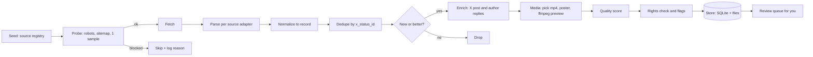

# Opus 5.5 prompts and videos: source map for the scraping agent

Research date: **2026-10-21** · Model: Claude Opus 5.5 (`claude-opus-5-5`, released 2026-09-22; Anthropic publishes a dedicated prompting guide for it) · Nothing here was scraped for content. Sources were found by web search, then the ones reachable from the research sandbox were cloned or fetched to read their **real structure**.

**Verification legend**

| Mark | Meaning |
|---|---|
| ✅ | Inspected directly (repo cloned, or files fetched). Schemas, counts and URLs below are observed, not assumed. |
| 🔎 | Found in search results only. Counts and structure come from search snippets or from other verified sources that reference it. The agent must run the **probe** in section 8 before trusting it. |
| ⚠️ | Known platform with a documented access method, but blocked in the research sandbox. Structure is from public documentation or from code in verified repos. |

---

## 1. What the research found

1. **GitHub is the best source.** Five community repos hold machine-readable datasets (JSON/CSV) of Opus 5.5 posts with the creators' prompts. No HTML scraping is needed for them: fetch raw files.
2. **Together they cover 1,623 unique X posts.** Measured by tweet ID across the five datasets (yihui 703, leadde 728, athemeroy 424, eastling 90, xrayluan 83). Overlap is small (for example yihui ∩ leadde = 217), so merging them multiplies coverage. **The X status ID is the dedupe key.**
3. **1,039 of those posts have prompt text** (counted over the three datasets that carry the text: yihui, leadde, eastling). 416 are 200+ characters, 200 are 500+, 128 are 1,000+, 86 are 2,000+, 34 are 5,000+. **87 are 1,000+ characters with real structure** (headings, tags, lists): this is the "premium quality" tier. They are listed in [`opus-5.5-seed-queue.csv`](opus-5.5-seed-queue.csv).
4. **Videos live on X, not on GitHub.** Datasets keep a poster image, a GIF preview, or an X link. The real MP4 comes from X (see S-X01). Two galleries host their own copies of posters and videos (Skillry, Prompt Motion).
5. **Anthropic publishes its own Opus 5.5 material as clean Markdown**: a prompting guide, the system prompt, best practices, and `llms.txt`. All verified reachable.
6. **Rights are the main risk, not access.** Every aggregator's licence covers only its own writing. Creators keep rights to their prompts and videos (stated in `RIGHTS.md` / `THIRD_PARTY.md` of three repos). See section 7 before you publish anything.

---

## 2. Master source table

Priority: **P0** start here · **P1** add next · **P2** nice to have · **P3** reference only.
"Prompts" and "Video" say where the actual text and media come from.

| ID | Source | URL | Type | Prompts | Video | Scale | Best way to get it | Licence / rights | ✔ | Pri |
|---|---|---|---|---|---|---|---|---|---|---|
| G01 | yihui-dev / awesome-opus5-5-videos | https://github.com/yihui-dev/awesome-opus5-5-videos | GitHub dataset | Full text in `data/videos.json` and `prompts/<slug>.md` | Poster WebP on `media.skillry.dev`; X link for the video; Skillry page for the remake | 703 records, 496 with a full (non-partial) prompt; last commit 2026-10-13 | Raw `data/videos.json` | MIT for the repo; creators own prompts and videos | ✅ | P0 |
| G02 | LeaddeOpenLab / awesome-opus-5-5-video-prompts | https://github.com/LeaddeOpenLab/awesome-opus-5-5-video-prompts | GitHub dataset | Full text in `data/library/<tweetid>.json` and `prompts/<tweetid>.md` | GIF preview `data/gifs/<id>.gif`, cover `pbs.twimg.com`; X link | 728 records, all with prompt text (median 137 chars, max 22,979); updated 2026-10-21 | Raw `data/library/<tweetid>.json` (list the folder with the Git tree API or a shallow clone) | No LICENSE file: treat as all rights reserved | ✅ | P0 |
| G03 | athemeroy / awesome-opus-5-5-videos | https://github.com/athemeroy/awesome-opus-5-5-videos | GitHub index | Not copied; `cases.csv` notes whether a prompt is shown | Stills only; X links | 424 posts in `collection-index.csv`, 168 reviewed cases; 2026-10-11 | Raw CSVs in `data/` | CC BY 4.0 for its own notes only. `THIRD_PARTY.md` says it grants no rights to posts, prompts or videos | ✅ | P1 (discovery, provenance) |
| G04 | eastling / awesome-opus-5.5-video-prompts | https://github.com/eastling/awesome-opus-5.5-video-prompts | GitHub dataset | Full text in `data/prompts.json` | Poster `pbs.twimg.com`; X link | 90 curated prompts, 11 categories, 11 templates; has likes, format, duration; 2026-10-02 | Raw `data/prompts.json` | CC0 for list structure and templates; prompts belong to creators | ✅ | P1 (engagement signal) |
| G05 | X-RayLuan / awesome-opus-5-5-video-prompts | https://github.com/X-RayLuan/awesome-opus-5-5-video-prompts | GitHub dataset + playbook | Verbatim text in `data/prompts/<slug>.txt`, index in `data/entries.json` | Compressed clips (≤10 MB) in `assets/videos/`; full video on X | 83 entries; repo is 831 MB (videos): use sparse checkout of `data/` and `scripts/` | Raw `data/entries.json`, then `data/prompts/<slug>.txt`. **Read `SCRAPE.md`**: it is a working X scraping playbook | MIT for tooling; `RIGHTS.md`: creators keep all rights, removal on request | ✅ | P0 (method) |
| G06 | TripoGrowthLab / awesome-opus-5-5-prompts | https://github.com/TripoGrowthLab/awesome-opus-5-5-prompts | GitHub catalog (CMS-synced) | In `docs/catalog.en.1.md` and `.2.md` as ```` ```text ```` blocks under `### <title>` | WebP previews in `assets/previews/`; detail pages on tripo3d.ai | 63 examples, 14 languages; 2026-10-02 | Parse the Markdown catalog (headings plus fenced blocks) | MIT for tooling; `RIGHTS.md`: does not relicense creators' work | ✅ | P1 (3D and games) |
| G07 | riba2534 / claude-opus-5-5-demo | https://github.com/riba2534/claude-opus-5-5-demo | GitHub demos | Prompts in each demo's README (Chinese) | Playable HTML demos | 3 demos: `pelican-bike`, `qq-speed`, `cf-transport-ship` | Clone (1.6 MB) | No licence file | ✅ | P3 |
| G08 | JohnHeibel / PDoomVideo | https://github.com/JohnHeibel/PDoomVideo | GitHub project | `STORYBOARD.md` (16 KB) and `ANIMATION_GUIDE.md` (12 KB) are the brief and the rules that produced a 156 s music video | Repo renders it (`render.mjs`); YouTube link in the X post | 1 project: the famous "9,500-character brief" | Clone (7.8 MB) | No licence file | ✅ | P2 (long-form brief example) |
| G09 | lemomo-ai / lemo-opuscar | https://github.com/lemomo-ai/lemo-opuscar | GitHub skill | `styles/<name>/STYLE.md` plus `styleboard/opuscar98_styles.json` (98-style catalog) and `catalog.json` | Demo films per style (large repo, 198 MB) | 43 styles imported already into cizle; the catalog now lists 98 | Raw `styleboard/opuscar98_styles.json`; sparse-checkout `styles/` | MIT (third-party assets keep their own terms) | ✅ | P1 (new styles beyond the 43) |
| G10 | asgeirtj / system_prompts_leaks | https://github.com/asgeirtj/system_prompts_leaks | GitHub archive | `Anthropic/claude-opus-5.5.md` (478 KB) and `Anthropic/claude-code/claude-code-opus-5.5.md` (388 KB); 883 Markdown files overall | none | Updated 2026-10-19; also Opus 5, 4.x, Sonnet 5.5, Haiku 5.5 | Raw files | **CC0** | ✅ | P2 (how Anthropic prompts) |
| G11 | elder-plinius / CL4R1T4S | https://github.com/elder-plinius/CL4R1T4S | GitHub archive | `ANTHROPIC/CLAUDE-OPUS-5.5.md` | none | Several vendors; last commit 2026-09-22 | Raw file | **AGPL-3.0**: do not bundle into a proprietary product | ✅ | P3 |
| G12 | x1xhlol / system-prompts-and-models-of-ai-tools | https://github.com/x1xhlol/system-prompts-and-models-of-ai-tools | GitHub archive | `Anthropic/` folder (Claude Code, Fable 5, Sonnet 5) | none | Last commit 2026-10-12 | Raw files | **GPL-3.0** | ✅ | P3 |
| G13 | anthropics / skills | https://github.com/anthropics/skills | GitHub, official | `skills/<name>/SKILL.md`: `frontend-design`, `canvas-design`, `algorithmic-art`, `theme-factory`, `brand-guidelines`, `slack-gif-creator`, `web-artifacts-builder`, `claude-api` … | none | 19 skills | Raw `SKILL.md` per skill | Per-skill `LICENSE.txt` (Apache-2.0 on `frontend-design`; **check each skill's own LICENSE.txt**) | ✅ | P1 (design prompts) |
| G14 | anthropics / claude-cookbooks | https://github.com/anthropics/claude-cookbooks | GitHub, official | Notebooks with example prompts | none | 373 MB clone: use sparse checkout | Sparse checkout | MIT | ✅ | P3 |
| G15 | heygen-com / hyperframes | https://github.com/heygen-com/hyperframes | GitHub, tooling | `skills/` (`hyperframes`, `hyperframes-cli`, `remotion-to-hyperframes`, `slideshow`, `figma`, `media-use` …): the skills Opus 5.5 videos are built with | Example compositions | Updated 2026-10-21; 403 MB clone: sparse `skills/` | Sparse checkout `skills/` | Apache-2.0 | ✅ | P2 (toolchain) |
| G16 | remotion-dev / skills | https://github.com/remotion-dev/skills | GitHub, tooling | `skills/remotion-*/SKILL.md` (best-practices, captions, render, saas, maps …) | none | 10 skills; updated 2026-10-19 | Raw `SKILL.md` | No licence file here. Remotion has its own company licence: read it before commercial use | ✅ | P2 |
| G17 | hesreallyhim / awesome-claude-code | https://github.com/hesreallyhim/awesome-claude-code | GitHub list | Links to skills, commands, workflows (not prompts) | none | `THE_RESOURCES_TABLE_NEW.csv`: 261 rows with Category, Link, Author, Active, Stale | Raw CSV | **CC BY-NC-ND 4.0**: no derivatives, no commercial use. Use for discovery only | ✅ | P2 (discover new repos) |
| G18 | langgptai / awesome-claude-prompts | https://github.com/langgptai/awesome-claude-prompts | GitHub list | General Claude prompts in `README.md` and `claudecode/` | none | ~230 list items; updated 2026-10-16 | Parse README | No licence file | ✅ | P3 |
| G19 | karanb192 / awesome-claude-skills | https://github.com/karanb192/awesome-claude-skills | GitHub list | Links to 50+ skills | none | Small | Parse README | MIT | ✅ | P3 |
| O01 | Anthropic: Prompting Claude Opus 5.5 | https://platform.claude.com/docs/en/build-with-claude/prompt-engineering/prompting-claude-opus-5-5.md | Official docs | The guide: effort, thinking, progress updates, frontend design, visual inputs, multiapp workflows | none | 28 KB Markdown | `GET` the `.md` URL (front matter has title, url, description) | Anthropic docs: quote and link, do not republish wholesale | ✅ | P0 |
| O02 | Anthropic: Prompting best practices | https://platform.claude.com/docs/en/build-with-claude/prompt-engineering/claude-prompting-best-practices.md | Official docs | Cross-model prompt patterns | none | 74 KB | `GET` the `.md` URL | as O01 | ✅ | P1 |
| O03 | Anthropic: Opus 5.5 system prompt | https://platform.claude.com/docs/en/release-notes/system-prompts/claude-opus-5-5.md | Official docs | The published system prompt | none | 27 KB | `GET` the `.md` URL | as O01 | ✅ | P2 |
| O04 | Anthropic docs index | https://platform.claude.com/llms.txt and https://platform.claude.com/sitemap.xml | Official index | Lists every doc as a `.md` link, including all model-specific prompting guides (Opus 5, 5.5, Sonnet 5.5, Haiku 5.5, Fable 5/5.1) | none | 89 KB `llms.txt`; 393 KB sitemap (many locales) | Crawl `llms.txt` | `robots.txt`: `Disallow: /api/` only | ✅ | P0 (watch for new guides) |
| O05 | Anthropic cookbook site | https://platform.claude.com/cookbook/sitemap.xml | Official | Cookbook entries | none | 100 URLs | Sitemap | as O01 | ✅ | P3 |
| O06 | Anthropic announcement + blog | https://www.anthropic.com/claude-opus-5-5 · https://claude.com/blog | Official | Launch page, webinars | Launch media | Server-rendered HTML (530 KB / 567 KB) | HTML + sitemap | `robots.txt`: `Allow: /` | ✅ | P3 |
| W01 | Prompt Motion | https://prompt-motion.com | Gallery | Prompt text in the Next.js payload (`"prompt":"…"`); long ones as `$<id>` references | `media.prompt-motion.com/<slug>/video.<hash>.mp4` and `preview.<hash>.mp4` | ~235 entries on the home page, 257 sitemap URLs | See recipe S-W01 | Prompts quote creators' X posts. `robots.txt`: `search=yes, ai-train=no, use=reference`; ClaudeBot and anthropic-ai disallowed | ✅ | P1 |
| W02 | Skillry | https://skillry.dev/ai-videos/opus-5-5 | Gallery (front for G01) | Same prompts as G01 | `media.skillry.dev/opus-5-5/<slug>/original.<hash>.webp`; live remake on page | 418 remakes of G01's 703 (per G01's README); paid tier $9.99/month | **Use G01 instead of scraping the site** | Site says creators keep their rights | ⚠️ | P3 |
| W03 | Claude Video | https://claudevideo.org | Gallery | Prompts where creators shared them | Embeds / links to X | 1,276 videos from 1,007 creators, 457 with prompts (per search) | Probe first (section 8) | Unknown | 🔎 | P2 |
| W04 | OpenChamber (name from a roundup; exact URL not found) | search the name | Gallery | 841 posts with author-published prompts | 5,054 X videos | As of 2026-10-07 per [woshipm roundup](https://www.woshipm.com/ai/6475015.html) | Locate URL, then probe | Unknown | 🔎 | P2 |
| W05 | PromptCat | https://promptcat.org | Gallery | 277 source-linked prompts (per search) | Playable videos | Per search snippet only | Probe | Unknown | 🔎 | P2 |
| W06 | YouMind prompt library | https://youmind.com/opus-5-5-prompts and https://youmind.com/video-prompts/<slug>-<id> | Gallery | Prompt per page, e.g. `dynamic-motion-graphics-showreel-12663`; has "customize" | Embedded | Numeric ids around 11621 to 12671 seen | Sitemap, then page parse (probe) | Unknown | 🔎 | P1 |
| W07 | Carat prompt gallery | https://carat.im/prompt-gallery/claude-opus-5-5 and `/prompt-gallery/p/<id>` | Gallery | Briefs with HTML/Playwright render steps; ids 42164 to 42363 seen | Published creator videos | Per search | Probe | Unknown | 🔎 | P1 |
| W08 | Jason Zhu prompt library | https://jasonzhu.ai/en/prompts/claude-opus-5-5 | Gallery | 1,854 works, 464 with the creator's prompt (205 full) per the site's own text in search | Embedded | Largest claimed | Probe | Unknown | 🔎 | P1 |
| W09 | Tripo prompt pages | https://www.tripo3d.ai/3d-prompts/claude-opus-5-5-<tweetid> | Gallery (front for G06) | Same as G06, "Prompt copied" button | Source images/video | URL pattern confirmed from G06 | Use G06 | See G06 | ✅ (via G06) | P3 |
| W10 | Hermes AI case library | https://hermes-ai.net/ai-models/claude-opus-5-5/case/<tweetid>/ | Gallery | Case pages keyed by tweet id (e.g. `2102462889160286423`) | Embedded X video | "9 cases" on one listing | Probe | Unknown | 🔎 | P3 |
| W11 | TopView video prompts | https://www.topview.ai/video-prompts | Gallery | "Motion Graphics Product Launch Video" and similar | Samples | Mixed models | Probe | Unknown | 🔎 | P3 |
| B01 | AIIDELIST: 20+ prompts guide | https://aiidelist.com/blog/opus-5-5-motion-design.md | Blog (Markdown endpoint) | 20+ templates: showreels, explainers, data-viz, Remotion/HyperFrames setup | none | One article | `GET` `.md` | Unknown: quote and link only | 🔎 | P1 |
| B02 | João Queiros: 30 examples | https://www.ai.joaoqueiros.com/blog/opus-5-5-video-motion-examples-prompts | Blog | 30 linked examples; **says its prompts are suggestions, not verified originals** | Links | One article | HTML | Unknown | 🔎 | P2 |
| B03 | apimaster.ai video prompts | https://apimaster.ai/blog/claude-opus-5-5-video-prompts | Blog | Copy-and-adapt prompts | none | One article | HTML | Unknown | 🔎 | P2 |
| B04 | iArt: 5 motion-graphics prompts | https://www.iart.ai/blog/claude-motion-graphics | Blog | 5 prompts incl. logo reveal | Result films | One article | HTML | Unknown | 🔎 | P2 |
| B05 | AY Automate resource | https://www.ayautomate.com/resources/claude-opus-5-5-motion-graphics | Blog | Showreel prompt and variants | none | One page | HTML | Unknown | 🔎 | P3 |
| B06 | Muzli: Opus 5.5 for designers | https://muz.li/blog/claude-opus-5-5-for-designers/ | Blog | 3 design briefs with the prompts used (2026-09-28) | Screens | One article | HTML | Unknown | 🔎 | P1 (design prompts) |
| B07 | MindStudio frontend workflow | https://www.mindstudio.ai/blog/opus-5-5-frontend-coding-workflow | Blog | Landing-page workflow, mood-board method | none | One article | HTML | Unknown | 🔎 | P2 |
| B08 | BNext (Taiwan): 10 style prompts | https://www.bnext.com.tw/article/92576/claude-opus-5.5 | Article (zh-TW) | 10 styles (pixel, recipe, Blender 3D, product launch, UI motion, step explainer…) with editable templates | Reference works | One article | HTML | Unknown | 🔎 | P2 |
| B09 | Woshipm roundup (zh) | https://www.woshipm.com/ai/6475015.html | Article | **A list of 10 gallery sites**: use it to find W04 and others | none | One article | HTML | Unknown | 🔎 | P1 (discovery) |
| B10 | ofox.ai guide | https://ofox.ai/blog/opus-5-5-video-prompts-mp4-guide/ | Blog | 3 original templates plus Remotion export | Sample project | One article (says the templates are original briefs) | HTML | Unknown | 🔎 | P3 |
| B11 | Better Stack prompting guide | https://betterstack.com/community/guides/ai/claude-opus-55-prompting-guide.md | Guide (Markdown endpoint) | How to prompt 5.5 | none | One article | `GET` `.md` | Unknown | 🔎 | P3 |
| B12 | Pasquale Pillitteri news series | https://pasqualepillitteri.it/en/news/19007/opus-5-5-motion-design-video-en | News (14 languages) | Summaries; names the 10,000-character-brief example | none | Many posts | HTML | Unknown | 🔎 | P3 |
| B13 | Simon Willison | https://simonwillison.net/tags/three-js/ and `/tags/svg` | Blog | Real prompts with outputs (Three.js game, pelican SVG) | Screens | Tag feeds: `…/tags/<tag>.atom` | Atom feed | His site; quote and link | 🔎 | P2 |
| X01 | X posts (primary source for G01–G05, W01–W11) | https://x.com/<handle>/status/<id> | Social | The post text; long prompts are often in the creator's own reply | Native video | 1,623 posts already identified (section 1) | See recipe S-X01 | X Terms prohibit scraping. Creators own the content | ⚠️ | P0 (via the datasets) |
| X02 | Seed post: the 15-second showreel | https://x.com/stephanlivera/status/2103315922098470926 | Social | `make a dynamic 15-second motion graphics video that shows what an incredible motion designer you are, like it's your showreel for a résumé. go all out.` | Native video | ~17k likes in G04 | S-X01 | As X01 | ✅ (via G04, W01) | P0 |
| R01 | Reddit: r/ClaudeAI, r/ClaudeCode, r/singularity | https://www.reddit.com/r/ClaudeAI/ | Community | Threads with prompts | Links | n/a | Official OAuth API; do not scrape HTML | Reddit API terms; blocked in the sandbox | ⚠️ | P2 |
| H01 | Hacker News (Algolia) | https://hn.algolia.com/api/v1/search?query=opus%205.5%20prompt | Community | Show HN posts and discussion | Links | n/a | Public JSON API | Free API, attribute | ⚠️ | P3 |
| Y01 | YouTube Data API v3 | https://developers.google.com/youtube/v3 | Video platform | Prompts in video descriptions and pinned comments | The video itself (link, do not download) | n/a | `search.list` then `videos.list` (API key) | YouTube API terms | ⚠️ | P2 |

> **Not found:** no Hugging Face dataset, Kaggle dataset or Notion template of Opus 5.5 prompts turned up in search. Re-check in a month.

---

## 3. Scrape recipes (verified sources)

All GitHub raw URLs follow `https://raw.githubusercontent.com/<owner>/<repo>/main/<path>` (default branch `main` on all, all returned HTTP 200). No auth needed. Prefer raw files over cloning; for large repos use `git clone --depth 1 --filter=blob:none --sparse` then `git sparse-checkout set <folders>`.

### S-G01 · yihui-dev dataset
- **Fetch:** `…/yihui-dev/awesome-opus5-5-videos/main/data/videos.json` (813 KB).
- **Shape:** array of 703 objects: `slug`, `author`, `author_url`, `post_url`, `category`, `tech_tags` (stringified list), `prompt`, `prompt_partial` (bool or "True"/"False" string), `poster_url`, `skillry_url`, `added` (date), `has_remake`.
- **Map:** `x_status_id` = last number in `post_url`; `prompt_status` = `partial` when `prompt_partial` is true; `video_urls` come later from X (S-X01); `poster_url` is a WebP on `media.skillry.dev`.
- **Gotcha:** many entries have a partial prompt or only the post. Keep the flag.

### S-G02 · LeaddeOpenLab dataset
- **Fetch:** list `data/library/` (728 files, one per tweet id), then `…/data/library/<tweetid>.json` (7 KB average). Cheaper: shallow clone with sparse `data/library` and `prompts` (the repo is 362 MB because of GIFs: do not clone `data/gifs`).
- **Shape:** `schemaVersion`, `storedAt`, `model` ("opus5.5"), `prompt`, `promptTranslations`, `summary`, `summaryEn`, `post`, `xUrl`, `coverUrl`, `coverPath`, `gifPath`, `imagePaths`, `distribution`, `modelStatus` ("identified"), `mediaCategory` ("video"), `mediaFingerprints`, `analysis`.
- **Map:** `x_status_id` from `xUrl`; text in `prompt`; poster `coverUrl`; keep `summaryEn` as a description.
- **Gotcha:** there is no LICENSE file. Also `prompts/<tweetid>.md` has sections (`## Prompt (English)`, `## What you need`, `## How to try it`) that add inputs and tools notes.

### S-G03 · athemeroy index
- **Fetch:** `…/athemeroy/awesome-opus-5-5-videos/main/data/collection-index.csv` (148 KB) and `data/cases.csv` (103 KB).
- **`collection-index.csv` columns:** `post_id, creator, source_url, first_listed_date, model_attribution, model_tags, entry_kind, media_evidence, title_en, title_zh, category, source_ledger, detail_page, thumbnail`.
- **`cases.csv` columns:** `source_url, primary_path, label, creator_disclosure, hypit_observation, review_note, duration_s, hypit_status`.
- **Use:** model attribution (`Opus` / `Sonnet` / `Haiku` / `Fable`), and `creator_disclosure` tells you how honestly the prompt was shared. Good for filtering out non-Opus posts.
- **Gotcha:** `data/` also has dated audit CSVs (`claude55-source-review-*.csv`, `claude55-candidate-audit-*.csv`): they are working files, large and noisy.

### S-G04 · eastling dataset
- **Fetch:** `…/eastling/awesome-opus-5.5-video-prompts/main/data/prompts.json` (105 KB).
- **Shape:** `{ categories[11], templates[11], prompts[90] }`; prompt fields: `id` (tweet id), `category`, `title`, `note`, `prompt`, `truncated`, `lang`, `author`, `authorName`, `postUrl`, `poster`, `likes`, `format` ("16:9"), `duration`, `tags`, `date`.
- **Use:** the only source with **likes** and **format/duration**: good quality signals.

### S-G05 · X-RayLuan dataset and playbook
- **Fetch:** `…/main/data/entries.json` (92 KB, 83 entries) and `…/main/data/prompts/<slug>.txt`.
- **Entry shape:** `slug, cat, title, title_zh, handle, name, post, links[[label,url]], desc, desc_zh, prompt{type, status, conv, start_after, end_before}`. Prompt `type` is `verbatim`, `excerpt`, `excerpt_author`, `author_description`, `repo_quotes` or `not_shared`: **an honest provenance label worth copying**.
- **Read `SCRAPE.md`** (full X workflow) and `scripts/fetch_x_media.py`, `scripts/extract_prompts.py`. Sparse-checkout only `data scripts`.

### S-G06 · Tripo catalog
- **Fetch:** `…/TripoGrowthLab/awesome-opus-5-5-prompts/main/docs/catalog.en.1.md` (133 KB) and `catalog.en.2.md`.
- **Parse:** each example is `<a id="claude-opus-5-5-<tweetid>">`, then `### <title>`, then a credit line `[creator](url) · date · Claude Opus 5.5 · Category`, then a **```` ```text ```` block that holds the prompt**. Web page: `https://www.tripo3d.ai/3d-prompts/claude-opus-5-5-<tweetid>`.

### S-G09 · lemo-opuscar styles
- **Fetch:** `…/lemomo-ai/lemo-opuscar/main/styleboard/opuscar98_styles.json` (470 KB). Top-level keys: `title, film, note, chapters, films`.
- **Style prompt:** `styles/<name>/STYLE.md` (about 52 folders, including `_template` and `archive-*`). cizle already imported 43; diff the catalog against `prompts/films/` to find new ones.

### S-G10 · system-prompt archive (reference, CC0)
- **Fetch:** `…/asgeirtj/system_prompts_leaks/main/Anthropic/claude-opus-5.5.md`, `…/Anthropic/claude-code/claude-code-opus-5.5.md`; official prompts in `Anthropic/official/`.
- **Note:** unofficial extractions. Prefer **O03** (Anthropic's own published system prompt) as the citable source.

### S-O (Anthropic docs)
- **Discover:** `GET https://platform.claude.com/llms.txt`; every entry is a `.md` URL. Filter lines containing `Prompting Claude`.
- **Fetch:** any `…/docs/en/…/<page>.md` returns Markdown with YAML front matter (`title`, `url`, `description`). New model guides appear as `prompting-claude-<model>.md`.
- **Poll:** diff `llms.txt` daily to catch new guides.

### S-W01 · Prompt Motion (server-rendered Next.js, no API)
1. **List:** `GET https://prompt-motion.com/` returns the whole list at once. `?p=N` pagination is client-side and ignored by the server. Entry links match `href="/<x-handle>-<6hex>"`. Skip `/templates`, `/customize`, `/blog`, `/tags`, `/sponsor`.
2. **Entry page** `GET /<slug>` (opens as a modal in the app, but the URL is a normal page):
   - `<script type="application/ld+json">` with a `VideoObject`: `name, description, contentUrl` (the MP4), `thumbnailUrl`, `uploadDate`, `width`, `height`, `creator{name,url}`.
   - Prompt: in the RSC payload (`self.__next_f.push([1,"…"])`), key `"prompt":"…"`. If the value is `"$27"`, it is a reference: find the record `27:T<hexlength>,<text>` in the concatenated payload and read exactly `hexlength` **bytes** of UTF-8.
   - Original post link: after the text "This prompt was taken directly from".
   - Model and effort: the `Model` / `Effort` / `Posted` `<dt>`/`<dd>` pairs. Tags: `a[href^="/tags/"]`.
3. **Media:** `contentUrl` (`…/video.<hash>.mp4`), poster `…/poster.<hash>.webp`, preview `…/preview.<hash>.mp4`.
4. **Reference implementation:** [`scripts/import-prompt-motion.mjs`](../../scripts/import-prompt-motion.mjs) in this repo already does steps 1–3 (40 entries imported, `NODE_USE_ENV_PROXY=1` needed on this sandbox).
5. **Politeness:** one request per second; honour the Content-Signal in its `robots.txt` (section 7).

### S-X01 · X posts (the video and the author's own prompt reply)
- **Primary key** is the status id: `https://x.com/<handle>/status/<id>`.
- **Without logging in to X:** the community playbook in G05 uses the public **fxtwitter** mirror API (a third-party service, not X):
  - Post: `GET https://api.fxtwitter.com/<handle>/status/<id>` → `tweet.text`, author, `created_at`, likes, views, `tweet.media.all[]` (`type` = `video`/`gif`/`photo`, `url`, `thumbnail_url`, `formats[]` with `url` and `bitrate`).
  - Thread and replies: `GET https://api.fxtwitter.com/2/conversation/<id>` → `status`, `thread`, `replies`. **Keep only replies whose author equals the post author**: this is where "prompt below 👇" lives.
  - Video pick: choose the highest-bitrate `.mp4` (not `.m3u8`) whose short side is at most 1080 (see `pick_variant` in `scripts/fetch_x_media.py`).
- **Official route:** X API v2 `GET /2/tweets/:id` with `expansions=attachments.media_keys` and `media.fields=variants,preview_image_url` (paid, needs a bearer token).
- **Status:** the fxtwitter API was **not reachable from the research sandbox**, so these field names come from verified repo code, not a live call. Test with one id before the full run.
- **Search for new posts:** X search needs a login. The G05 playbook uses a web search engine for `"Opus 5.5" video`, `"Opus 5.5" Blender`, `"Opus 5.5" Remotion OR HyperFrames`, plus Chinese/Japanese variants, then fetches each candidate by id.

---

## 4. One unified record (what the agent stores)

```jsonc
{
  "id": "x:2103315922098470926",           // "x:<status id>", else "h:<sha1 of normalized prompt[0:500]>"
  "x_status_id": "2103315922098470926",
  "post_url": "https://x.com/stephanlivera/status/2103315922098470926",
  "author": { "handle": "stephanlivera", "name": "Stephan Livera", "url": "https://x.com/stephanlivera" },
  "title": "The original showreel prompt",
  "category": "showreel",                  // normalize to: showreel|launch|ui|social|explainer|story|music|3d|games|generative|design|other
  "prompt": {
    "text": "make a dynamic 15-second …",
    "status": "verbatim",                  // verbatim | partial | excerpt | author_description | reconstructed | not_shared
    "chars": 156, "lang": "en", "structured": false,
    "extra_replies": []                    // author's follow-up replies that continue the prompt
  },
  "model_claim": { "text": "Opus 5.5", "evidence": "creator_post|aggregator|inferred", "effort": "Max" },
  "tools": ["canvas","remotion"], "duration_s": 15, "aspect": "16:9",
  "media": {
    "video_urls": ["https://video.twimg.com/…/1280x720/…mp4"], "poster_url": "https://pbs.twimg.com/…jpg",
    "local_video": "media/2103315922098470926.mp4", "local_poster": "media/2103315922098470926.webp",
    "other_hosts": [{ "site": "prompt-motion", "url": "https://media.prompt-motion.com/…mp4" }]
  },
  "engagement": { "likes": 16983, "views": null, "as_of": "2026-10-21" },
  "found_in": [ { "source": "G04", "ref": "data/prompts.json#2103315922098470926" }, { "source": "G01", "ref": "…" } ],
  "rights": { "owner": "creator", "licence": "unknown", "source_licence": "CC0 list only", "permission": "none|requested|granted", "removal_requested": false },
  "quality": { "score": 0, "flags": [] },
  "scraped_at": "2026-10-21T00:00:00Z"
}
```

**Dedupe rule:** same `x_status_id` ⇒ merge. Keep the **longest non-partial prompt**, union `found_in`, and remember which source supplied each field.

---

## 5. Agent graph (simple, resumable, runs locally on Hono)



| Node | Input → output | Rules |
|---|---|---|
| **Seed** | `sources.json` (the ID, URL, adapter, rate, enabled flag from section 2) | Order by priority. Disable anything that fails the probe. |
| **Probe** | source → `{robots, sitemap, sample_ok, notes}` | Fetch `robots.txt`, parse `Content-Signal` and `Disallow`, fetch 1 sample, store the findings. |
| **Fetch** | URL → bytes | One host at a time, ≥1 s between requests, `If-None-Match` caching, descriptive User-Agent with contact email, stop on 429/403. |
| **Parse** | bytes → raw fields | One adapter per recipe in section 3. Adapters for GitHub JSON need no HTML parsing. |
| **Normalize** | raw → record (section 4) | Language detect, strip tracking params, normalize category and tools. |
| **Dedupe** | record → merged record | Key `x_status_id`; fall back to prompt hash. |
| **Enrich** | status id → author replies and media | S-X01. Cap at N per hour. Cache raw JSON under `raw/`. |
| **Media** | media URLs → files | Download only what the rights policy allows (section 7). Always store the poster; store the MP4 only for items you have permission for. |
| **Quality** | record → score | Section 6. |
| **Rights** | record → flags | Section 7. |
| **Store** | record → SQLite row, files under `media/` and `raw/` | Idempotent upsert. Keep a `runs` table so a crash resumes. |

Suggested stack: Hono routes `POST /runs`, `GET /runs/:id`, `GET /records?min_score=…`, a job queue in SQLite, `ffmpeg` for previews, Zod for the record schema.

---

## 6. "Premium quality" filter

A record is **premium** when all hard rules pass, ranked by the score.

**Hard rules**
1. `model_claim` names **Opus 5.5** explicitly (not "Claude", Opus 5, 4.x, Sonnet, Haiku or Fable). The athemeroy `model_attribution` column and the G05 qualification rules make this check cheap.
2. `prompt.status` is `verbatim` (or `excerpt` with the creator's marker). Never keep `reconstructed` as if it were the creator's.
3. `prompt.chars ≥ 1000`.
4. There is a video or a repo that renders one.

**Score (0–100):** structure 30 (headings, `[TAGS]`, XML-like tags, numbered shots, timeline), length 20 (log scale to 5,000), specificity 15 (named tools, durations, resolutions), engagement 15 (likes from G04 or fxtwitter), has inputs/tools notes (G02 sections) 10, found in 2+ sources 10.

Measured result: **87 posts pass 1,000+ characters with structure**, listed in the seed queue. Examples at the top: @HeyAbhishek (22,979 chars), @alexwtlf (22,367), @gmgmgm1545 (17,549), @agentgamesbot (17,098), @froessell (12,497, in 3 datasets), @iamtanzil_ (10,959, in 3 datasets).

---

## 7. Rights and rules of engagement (read before you republish)

- **Creators own their prompts and videos.** The MIT, CC0 and CC BY licences on aggregator repos cover only the aggregators' own writing. Three repos say so explicitly (`THIRD_PARTY.md`, `RIGHTS.md`). Two repos have **no licence file at all** (G02, G08), which means all rights reserved.
- **Restrictive licences:** G17 is **CC BY-NC-ND** (no derivatives, no commercial use). G11 is **AGPL-3.0** and G12 is **GPL-3.0**: do not bundle their text into a proprietary product.
- **Prompt Motion** publishes `Content-Signal: search=yes, ai-train=no, use=reference` and disallows several AI crawlers by name. Treat it as reference, not as a feed to republish.
- **X Terms** prohibit scraping, and the fxtwitter mirror is a third-party service. Use it lightly for verification and media, prefer the datasets, and consider the paid official API if the run is large.
- **For a paid marketplace** the safe pattern is: store everything locally for study and ranking; publish **your own rewritten skill** that cites the original ("inspired by @handle, link"), or publish the original **only with the creator's permission** (add `rights.permission = granted` and keep the proof). Never re-host creators' videos: link to the post.
- **Honour removal requests** immediately (all verified repos promise to).
- Verify attribution yourself: several aggregators label models inconsistently ("Opus 5", "Opus 5.5", "Fable").

---

## 8. Probe checklist for the unverified sources (🔎 and ⚠️)

Run once per source before enabling it; save the output in the run log.

1. `GET /robots.txt` → record `Disallow`, `Crawl-delay`, any `Content-Signal` line. Stop if your path or User-Agent is disallowed.
2. `GET /sitemap.xml` (and `sitemap_index.xml`) → count URLs, find the pattern for prompt pages (for example `/video-prompts/<slug>-<id>`, `/prompt-gallery/p/<id>`).
3. `GET /llms.txt` → many 2026 sites publish one.
4. Open one prompt page and test, in this order: JSON-LD `VideoObject`/`CreativeWork`; `__NEXT_DATA__` or `self.__next_f` payload; an XHR/`fetch` call returning JSON (look for `/api/…` in the page source); plain HTML. Prefer the first one that works.
5. Check pagination: is the full list in the first response (as on prompt-motion.com), a `?page=` parameter, a cursor API, or infinite scroll?
6. Find the media: `contentUrl`, `<video src>`, `<source>`, `og:video`, or an X/YouTube embed. Note the CDN host.
7. Look for a "prompt" button or a copy field: its `data-` attribute or the surrounding JSON often holds the full text.
8. Read Terms and licence text; record the sentence about scraping or reuse.
9. Take 3 sample records and compare them with the same post on X to confirm the prompt is the creator's own text and not a reconstruction.
10. Only then add an adapter, set the rate limit, and enable the source.

*If you open network access to the 🔎 domains for a session, this verification can be completed here and this table updated.*

---

## 9. Appendices

### A. Most prolific creators in the datasets (X watchlist)
1,001 creators appear across the datasets. Top by number of distinct posts: `@vib3coded` (11), `@konstantinsaifo` (9), `@twoclipping` (8), `@aichrislee` (8), `@curieuxexplorer` (7), `@jeffbruchado` (7), `@maker_evan` (6), `@buildfastwithai` (5), `@ivanainai` (5), `@threeaus` (5), `@olezhavich` (5), `@genuenci` (5), `@ajith_io` (4), `@sudo_kiran` (4), `@gdgtify` (4), `@akokoi1` (4), `@juancarlos17626` (4), `@rubenssoto_ai` (4), `@ottollm` (4). These are good accounts to poll for new posts and to ask for permission.

### B. Seed queue
[`opus-5.5-seed-queue.csv`](opus-5.5-seed-queue.csv): 87 rows (`x_status_id, author_handle, post_url, prompt_chars, found_in_sources, category_hint`), longest and most structured first. Start the agent here: fetch the prompt from the listed dataset source, enrich the video from X, then score.

### C. Method and limits
- Discovery used web search (about 30 queries). Verification cloned 19 public GitHub repos and fetched Anthropic's docs and prompt-motion.com. Counts for 🔎 sources are the sites' own claims in search snippets and can differ between pages.
- The sandbox could not reach X, Reddit, Hugging Face, Hacker News and most gallery sites, so those structures are not verified here. The fxtwitter field names come from the code in G05.
- Star counts are deliberately omitted: the GitHub API was unavailable, and search-snippet counts disagree.
